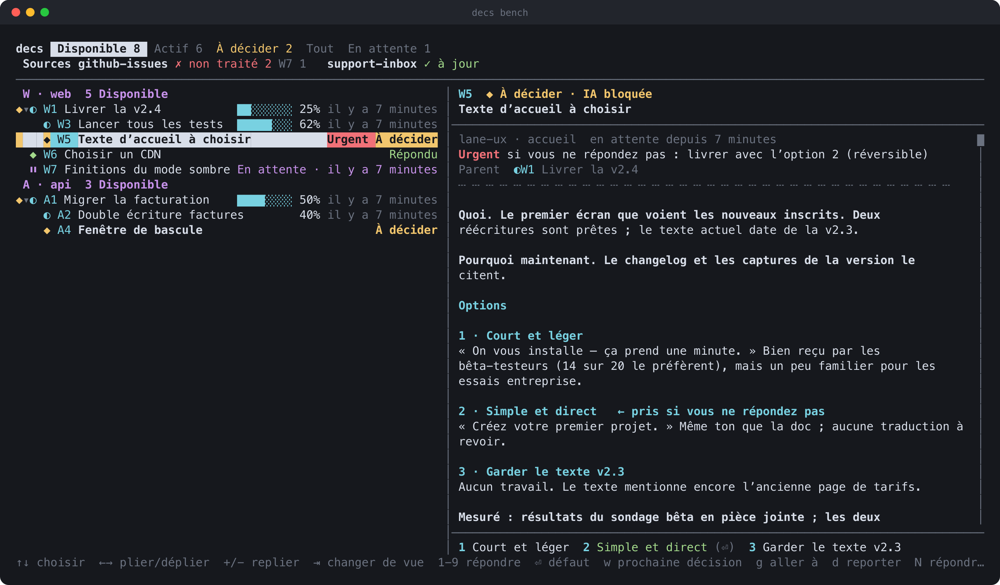

[English](README.md) · [简体中文](README.zh-Hans.md) · [繁體中文](README.zh-Hant.md) · **Français** · [العربية](README.ar.md)

# decisions-md

**`decs` est un centre de tâches et de décisions pour les agents IA de longue durée.**
Chaque action d’un agent — et chaque question qu’il doit vous poser — est un simple
fichier markdown dans votre dépôt. Vous regardez tout cela sur un seul écran de
terminal permanent, le **bench**, et vous répondez d’une touche.

Pas de base de données. Pas de démon. Pas de serveur. Juste un dossier
`decisions/` dans git.



<sub>Données fictives, générées par le vrai code du bench avec `node scripts/render-screenshot.ts`.</sub>

---

## Le problème

Vous confiez à un agent une tâche de deux heures — ou cinq agents, chacun la
sienne. Et ensuite :

- **« Dois-je… ? »** Les agents s’arrêtent et demandent dans le chat. Si vous
  n’êtes pas en train de regarder, la question reste en suspens ; si vous
  répondez, la réponse disparaît dans le défilement et la session suivante
  ne l’a jamais vue.
- **La progression s’efface.** Un test prend une heure. Que fait-il ? Vous ne
  pouvez que demander — et l’interrompre pour le savoir.
- **Des agents en parallèle se télescopent.** Cinq voies qui modifient le
  même `TODO.md` tombent sur le même numéro, écrasent les lignes des autres,
  archivent la mauvaise entrée.
- **Personne ne sait ce qui reste à faire.** Le suivi des tickets est-il à
  jour ? La boîte de support a-t-elle été traitée ? Quelle voie est bloquée,
  laquelle attend une personne ?

## L’idée

Une seule sorte de chose — un **nœud** — et un seul espace d’identifiants.

Un nœud est quelque chose que l’IA fait. Quand l’agent sait comment faire,
il le fait, tout simplement. Quand il a d’abord besoin du propriétaire, le
nœud devient **à décider**, avec des options, une valeur par défaut, et ce
qui se passe si personne ne répond. Un nœud en cours qui tombe sur une
question ne crée pas une deuxième entrée ; il se transforme lui-même en
question, et redevient actif dès que vous répondez.

```
decisions/
  decs.json                                  # {"letter": "W"} → refs read W12
  active/12-ship-v2-4.md                     # a root node still in play
  active/12-ship-v2-4/13-run-test-suite.md   # its children live in its folder
  archived/9-rotate-api-keys.md              # done or closed, kept forever
  attachments/12/after.png
  .ids/12                                    # zero-byte reservation (O_EXCL)
```

Parce que chaque nœud est son propre fichier et que les identifiants sont
réservés avec `O_EXCL`, n’importe quel nombre d’agents peut écrire en même
temps sans collision. Parce que c’est du markdown dans git, vous avez
l’historique, les diffs, la revue et `grep` gratuitement.

## Ce que vous obtenez

**Pour l’humain — le bench.** `decs bench` est une interface terminal en
direct sur tous les projets que vous avez enregistrés. Cinq onglets :

| onglet | affiche |
|---|---|
| **Disponible** | ce qui peut avancer maintenant : en cours, en attente de quelqu’un, prêt à démarrer, qui vous attend, répondu |
| **Actif** | ce qui se passe : seulement en cours et à décider |
| **À décider** | uniquement les questions pour vous, par projet, celles qui bloquent un agent en premier |
| **Tout** | tout, les nœuds terminés repliés dans une ligne `✓ Terminé N` |
| **En attente** | bloqué à l’extérieur — un·e collègue, un·e client·e, un service — l’attente la plus longue en premier |

Le panneau de gauche est l’arbre des nœuds avec barres de progression et
péremption (gris passé 30 minutes sans mise à jour, rouge passé une heure).
Le panneau de droite montre le nœud sélectionné : statut, urgence,
*« si vous ne répondez pas »*, parent, dépendances, corps, pièces jointes.
Appuyez sur `1`–`9` pour répondre, `Enter` pour la valeur par défaut. Les
captures d’écran s’affichent directement dans le terminal (iTerm2, kitty,
Ghostty, WezTerm).

**Pour l’agent — une CLI et un contrat.** Les agents créent des nœuds, les
découpent en nœuds enfants, rapportent leur progression, posent des
questions, et sont notifiés de vos réponses :

```sh
decs add "Ship v2.4" --task --author "lead · release"          # → W12
decs add "Run full test suite" --task --parent W12 --after W14
decs start W13
pytest | decs progress --parse pytest                           # bar moves by itself

decs ask W15 -o 1="Short & playful" 2="Plain & direct" --default 2 <<'EOF'
**What.** The first screen new users see after sign-up …
EOF
```

**Des notifications sans interrogation.** `decs monitor` affiche une ligne
pour chaque chose qu’un agent doit traiter — une réponse du propriétaire,
une relance, un nouvel élément d’une source externe, une réponse que
personne n’a récupérée depuis cinq minutes — et se souvient d’où chaque
session s’est arrêtée. Le plugin Claude Code le démarre pour toute la
session (`decs monitor --here`, qui surveille le projet courant) ; il se
déconnecte de lui-même après deux heures de calme avec une ligne
`DECS-IDLE`. Les sous-agents, ou une session après `DECS-IDLE`, l’arment
avec l’outil Monitor de Claude Code :

```
Monitor({ command: "decs monitor --mine", description: "decs", timeout_ms: 1800000 })
```

**Dépendances et ordre.** `--after W13` retient un nœud jusqu’à ce que W13
soit terminé. Vous pouvez tout de même répondre à une question en avance ;
le nœud attend alors **à faire** et démarre quand son tour vient.

**Sources externes.** Pointez un petit adaptateur vers des issues GitHub,
une boîte de support ou un formulaire de retour. Il synchronise
*uniquement des références* (identifiant + titre, url/état/origine en
option), jamais le corps, jamais les identifiants de connexion. L’en-tête
du bench vous dit, par source, si elle est à jour et qui détient quoi :

```
Sources github-issues ✗ non traité 2 W7 1   support-inbox ✓ à jour
```

**Des portes d’approbation pour tout ce qui sort.** Attachez un brouillon
avec `--approval-content` ; decs enregistre son sha256. Avant d’envoyer,
l’agent lance `decs approved W20 --check draft.html` — ça échoue sauf si
*vous* avez choisi l’option d’approbation *pour exactement ce contenu*. Un
agent qui relaie un « envoyez-le » depuis le chat ne peut pas approuver en
votre nom.

**Reporter.** Appuyez sur `d` sur tout ce que vous voulez mettre de côté.
Cela retire l’élément des vues de travail sans changer son état, et
l’agent qui le traite reçoit 「owner 延迟」 et s’arrête jusqu’à ce que vous
le leviez.

## Démarrage rapide

Nécessite Node 22.18+ (TypeScript s’exécute directement ; pas d’étape de
build).

```sh
git clone https://github.com/wecarbon/decisions-md.git
cd decisions-md && npm install
export PATH="$PWD/bin:$PATH"          # add to your shell profile

cd ~/code/your-project
decs init --letter W                  # creates decisions/, registers the project
decs add "Try decs" --task --author "me · kicking the tyres"
decs                                  # the bench (same as decs bench); q to quit
```

### Avec Claude Code

Le dépôt est aussi une marketplace de plugin Claude Code. Le plugin injecte
les règles d’usage au début de chaque session (plus les nœuds ouverts du
projet, pour qu’une session reprise retrouve son propre travail), démarre
`decs monitor` pour la session afin que vos réponses atteignent l’agent
sans qu’il ait à interroger, et rappelle à l’agent d’enregistrer ce que
vous dites d’un nœud dans le chat avant de répondre.

```
/plugin marketplace add wecarbon/decisions-md
/plugin install decs@decisions-md
```

(`/plugin marketplace add /path/to/decisions-md` fonctionne aussi pour un
clone local.)

Le guide complet pour les agents est [`AGENTS.md`](AGENTS.md) — copiez-le
dans votre propre `AGENTS.md` / `CLAUDE.md` si vous utilisez un autre
harnais d’agent. Les règles sont des appels CLI, donc n’importe quel agent
avec un shell peut les suivre.

## Langue

`decs` parle anglais, 简体中文 (chinois simplifié), 繁體中文 (chinois
traditionnel), français et العربية (arabe). Il en choisit une, dans cet
ordre :

1. `--lang <code>` sur n’importe quelle commande, par ex. `decs bench --lang fr`
2. la variable d’environnement `DECS_LANG`
3. `decs config lang <code>` — stockée par utilisateur dans
   `~/.decs/config.json` (`$DECS_HOME/config.json`). `decs config lang`
   seule affiche la langue actuelle et son origine ; `decs config lang --off`
   la retire.
4. la locale système (`LC_ALL` / `LC_MESSAGES` / `LANG`, `C` / `POSIX`
   ignorés) : `zh_CN` → `zh-Hans`, `zh_TW` / `zh_HK` → `zh-Hant`, `fr_*` →
   `fr`, `ar_*` → `ar`
5. la langue d’affichage du système, quand aucune de ces variables n’est
   définie — les terminaux Windows standards (cmd, PowerShell) n’en ont
   aucune, donc decs la lit comme `Intl` de Node la rapporte
6. sinon, l’anglais — c’est aussi là qu’aboutit une locale que decs ne
   traduit pas

Codes : `en`, `zh-Hans`, `zh-Hant`, `fr`, `ar`. Les règles de début de
session et le rappel de prompt du plugin suivent la même
résolution (`plugin/rules.<code>.md`).

L’arabe s’écrit de droite à gauche. `DECS_BIDI=visual|terminal` (ou
`decs config bidi visual|terminal`, `--off` pour retirer) choisit
comment : `visual` (par défaut) fait réordonner chaque ligne par decs
lui-même avec l’algorithme bidirectionnel Unicode, pour les terminaux qui
dessinent strictement de gauche à droite (par ex. le Terminal de macOS) ;
`terminal` fait écrire decs dans l’ordre logique et enveloppe les segments
de gauche à droite intégrés (références comme W12, nombres, commandes,
titres en anglais) dans des isolats Unicode, pour les terminaux qui
appliquent eux-mêmes le bidi (iTerm2 avec bidi activé, kitty, les
terminaux basés sur VTE). En arabe, le bench se met aussi en miroir : la
liste à droite, les détails à gauche. La sortie vers un pipe et `--json`
reste toujours dans l’ordre logique, donc les scripts et les agents la
lisent sans changement. Les heures relatives (« il y a 3 jours ») suivent
aussi la langue.

Le format de fichier sur disque ne change jamais avec la langue : decs
écrit toujours les mêmes titres et jetons (`## 选项`, `### 1 · …`,
`## 已答（…）`, `## 回复（…）`, `## 补充（…）`, `## 附件`, `## 子问题`,
`验收通过`, …), si bien qu’un dépôt reste lisible par chaque coéquipier·ère
quelle que soit la langue de sa CLI. L’analyseur accepte aussi
`## Options`, `## Attachments`, `## Questions` quand vous écrivez un
fichier à la main. Voir [Le format de fichier](#le-format-de-fichier)
ci-dessous.

## Le déroulement d’une session

1. Vous donnez un objectif à l’agent principal. Il lance
   `decs add "Ship v2.4" --task`, le démarre, et le découpe en nœuds
   enfants avec des dépendances `--after`.
2. Il distribue des voies (sous-agents) avec leurs propres nœuds. Chaque
   voie connecte ses longues commandes à `decs progress` ; les barres du
   bench avancent seules.
3. Une voie tombe sur une fourche. Elle lance `decs ask <id> -o …` avec des
   options, des coûts et une valeur par défaut. Le nœud devient un `◆`
   jaune sur votre bench.
4. Vous appuyez sur `2`. `decs monitor` réveille la voie ; elle lance
   `decs read`, continue, et termine par
   `decs done <id> --note "412/412 passing"`.
5. Vous n’avez jamais eu à demander « où en sommes-nous ? » — et la semaine
   suivante, toute l’histoire est encore dans `decisions/archived/`.

## Aide-mémoire CLI

| | |
|---|---|
| `decs init [--letter W]` | crée `decisions/` ici et enregistre le projet |
| `decs add <title> [--task] [-o 1=… 2=…]` | nouveau nœud ; avec des options, il devient à décider. Le corps vient de stdin |
| `decs add <title> --parent W12 --after W13` | nœud enfant, ordonné après un autre |
| `decs start / done / close <id>` | À faire → En cours → Terminé / Fermé (`--reason obsolete\|superseded\|merged-into:W15`) |
| `decs ask <id> -o 1=… 2=…` | un nœud en cours a besoin du propriétaire |
| `decs hold <id> --on "Carol: icon set"` | en attente de quelqu’un à l’extérieur ; ne compte pas comme bloqué |
| `decs progress <pct> "msg"` · `… \| decs progress --parse pytest` | rapporter la progression (ou laisser un pipe le faire) |
| `decs steps <id> "a" "b" "c"` · `decs step <id> 2` | travail en plusieurs étapes, le pourcentage est calculé pour vous |
| `decs note <id> "…"` | ajoute une note (agent par défaut ; `--human` pour le propriétaire) |
| `decs push <id> 2 [--note …]` | enregistre une réponse |
| `decs monitor [--mine] [--here] [--idle-exit 2h]` | le flux de notifications de l’agent |
| `decs read <id>` · `decs queue` | récupère les réponses / voir ce qui n’est pas encore récupéré |
| `decs attach <id> file [--approval-content --approve-on 1]` | attache un fichier ; verrouille-le sur une approbation |
| `decs approved <id> --check <file>` | ne sort en 0 que si exactement ce contenu a été approuvé |
| `decs defer <id>` · `decs undefer <id>` | reporter / reprendre |
| `decs show [open\|active\|deferred\|…] [--stale]` · `decs tree` · `decs get <id>` | lire le dépôt de données |
| `decs search <words> [--all]` | titres, corps, notes, noms de pièces jointes |
| `decs source register/sync/push/list/items/ack` | sources externes |
| `decs changes --since <t>` | tout ce qui suit un curseur, pour se remettre à niveau |
| `decs bench [.\|<dir>…] [--view decide]` | l’écran en direct |
| `decs` | dans un terminal, comme `decs bench` ; en pipe ou dans un script, affiche l’aide |
| `decs config [<réglage> [<valeur>\|--off]]` | vos réglages : lang, bidi, view, images, mouse, idle-exit, unclaimed-after (aussi dans le bench : `,`) |

Les identifiants s’écrivent `305`, `W305` (lettre du projet), `web:305`
(nom du projet), ou l’ancien `D305`. `decs <command> --help` a le reste.

## Raccourcis du bench

| touche | |
|---|---|
| `↑` `↓` | déplacer |
| `←` `→` · `-` `+` | replier / déplier (mémorisé entre les sessions) |
| `Tab` `Shift-Tab` | changer de vue |
| `1`–`9` · `Enter` | répondre · prendre la valeur par défaut |
| `w` | aller au prochain nœud sur lequel un agent est bloqué |
| `g` ou `:` | aller à un identifiant |
| `N` | répondre sans décider (le nœud retourne à l’agent) |
| `d` | reporter / reprendre |
| `X` · `A` | fermer avec un motif · marquer comme vu et archiver |
| `T` `B` `U` | épingler en haut / en bas / désépingler |
| `i` · `o` | choisir et voir des images · ouvrir une pièce jointe |
| `j` `k` `Ctrl-F` `Ctrl-B` | faire défiler le panneau de détail |
| `Z` · `?` · `q` | corps condensé · toutes les touches · quitter |
| `,` | réglages (langue, texte de droite à gauche, souris, …) |

La souris marche aussi : cliquez un onglet, un nœud, une option ou une
pièce jointe ; la molette fait défiler le panneau sous le curseur.

## Le format de fichier

Un nœud est du markdown avec un en-tête YAML. Les humains peuvent le lire
dans n’importe quel éditeur ; les agents et le bench passent par la CLI,
qui gère le verrouillage et l’historique.

```markdown
---
id: 1
title: Choose a CDN
author: lane-perf · static assets
status: needs_decision
created: 2026-03-14T10:12:03+00:00
urgency: high
default: "1"
if_no_answer: stay; re-measure Friday
reversible: true
---

**What.** Static assets are served from one region.

**Why now.** APAC p95 doubled last week.

## 选项

### 1 · Stay on current CDN

### 2 · Move to edge provider

## 补充（agent · lane-perf · static assets · 2026-03-14 10:20:41）

Measured again: 1.9 s p95 from Singapore.
```

Ces titres — `## 选项`, `## 补充（…）`, et les autres — sont des jetons
fixes, non traduits : voir [Langue](#langue) ci-dessus pour pourquoi, et
comment chaque personne choisit la sienne.

Statuts : `not_started` À faire · `in_progress` En cours · `waiting` En
attente · `needs_decision` À décider · `decided` Décidé, pour l’IA ·
`completed` Terminé · `closed` Fermé. Les nœuds enfants vivent dans un
dossier nommé comme le fichier de leur parent ; les identifiants restent
plats, donc déplacer un nœud n’est qu’un renommage et chaque référence
tient toujours.

## Principes de conception

- **Des fichiers, pas un service.** Tout est dans `decisions/`, versionné
  avec votre code, lisible sans decs installé.
- **Le système de fichiers est le verrou.** Les identifiants viennent de
  fichiers `O_EXCL` ; chaque écriture relit le nœud sous son propre verrou
  et se pose par écriture-puis-renommage. Deux douzaines d’écrivains
  concurrents obtiennent des identifiants consécutifs et ne perdent rien —
  il y a un test pour ça.
- **Une seule sorte de chose.** Tâches et décisions sont le même nœud.
  Moins de concepts, un seul espace d’identifiants, un seul arbre.
- **L’humain n’a jamais à demander.** Statut, progression, péremption, qui
  attend quoi — tout est sur le bench, pas dans un fil de chat.
- **Les rôles sont explicites.** Chaque section ajoutée dit si c’est un
  humain ou un agent qui l’a écrite, qui, et quand. Seules les réponses
  humaines approuvent le contenu sortant.
- **Des références, pas du contenu, depuis l’extérieur.** Les sources
  externes synchronisent des identifiants et des titres ; le corps et les
  identifiants de connexion restent là où ils vivent.

## FAQ

**Est-ce seulement pour Claude Code ?**
Non. La CLI est agnostique côté agent — tout ce qui a un shell peut
l’appeler. Le plugin Claude Code ajoute des règles de début de session et
utilise `CLAUDECODE` / `CLAUDE_SESSION_ID` pour distinguer les shells
d’agent des vôtres, et marquer qui a écrit quoi. Ailleurs, réglez
`DECS_ROLE=agent` et `DECS_SESSION`.

**Pourquoi l’interface est-elle en chinois ?**
Elle ne l’est plus — `decs` parle anglais par défaut, plus 简体中文,
繁體中文, français et العربية ; voir [Langue](#langue) ci-dessus. Les
commandes, les options et le format de fichier sur disque restent les
mêmes jetons chinois fixes dans chaque langue, pour qu’un dépôt écrit par
une équipe multilingue continue de s’analyser. Les titres et les corps
peuvent toujours être dans n’importe quelle langue, comme avant.

**Ça marche avec les git worktrees ?**
Oui. `decs` résout toujours vers le `decisions/` du clone principal, donc
les voies dans des worktrees partagent un seul dépôt de données.

**Plusieurs dépôts à la fois ?**
`decs init` enregistre chaque projet ; `decs bench` sans argument ouvre
tous les projets, groupés par lettre de projet.

**Et si personne ne répond ?**
Chaque question porte une valeur par défaut et un `--if-no-answer`.
`decs wait --timeout` sort avec le code 2 et affiche la valeur par défaut
— le moment d’avancer avec elle.

**Puis-je modifier les fichiers à la main ?**
Vous pouvez les lire librement. Pour écrire, utilisez la CLI : elle garde
les identifiants, les verrous, la file des réponses et l’historique des
pièces jointes cohérents.

**J’ai un vieux `DECISIONS.md`.**
`decs migrate --dir <project> --dry-run`, puis sans `--dry-run`.

## Développement

```sh
npm test            # node --test
npm run typecheck   # tsc --noEmit
node scripts/render-screenshot.ts --out docs/screenshot.fr   # regenerate docs/screenshot.<lng>.svg/.png (mock data)
```

## Licence

[MIT](LICENSE) © 2026 WeCarbon
