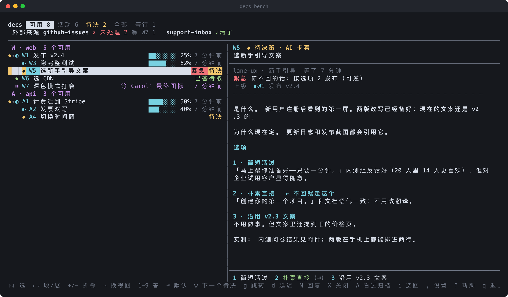

[English](README.md) · **简体中文** · [繁體中文](README.zh-Hant.md) · [Français](README.fr.md) · [العربية](README.ar.md)

# decisions-md

**`decs` 是给长时间运行的 AI 智能体用的任务与决策中枢。**
智能体做的每一件事——以及每一个需要*你*来回答的问题——都是仓库里的一个纯文本 markdown
文件。你在一个常驻的终端屏幕上看到全部，这就是 **看板**，按一个键就能答复。

没有数据库，没有常驻进程，没有服务器，只有 git 里的 `decisions/`。



<sub>示例数据，用真实的看板代码通过 `node scripts/render-screenshot.ts` 渲染而成。</sub>

---

## 问题

你把一件两小时的活交给一个智能体——或者五个智能体，各做一块。接下来会发生：

- **"要不要……？"** 智能体在对话里停下来问。你不在，问题就一直晾着；你答了，答案
  滚走了，下一个会话根本没看到。
- **进度看不见。** 一个测试要跑一小时，它在干什么？你只能去问——打断它才能知道。
- **并行的智能体互相打架。** 五条工作线同时改一个 `TODO.md`，挑中同一个编号，
  覆盖彼此的行，归档错了条目。
- **没人知道还剩什么。** issue 跟踪器清空了吗？客服邮箱处理了吗？哪条工作线卡住了，
  哪条在等人？

## 思路

一种东西——**节点**——一个编号空间。

节点是 AI 要做的一件事。智能体自己知道怎么做，就直接做。需要先问负责人的，
节点就变成**待决策**，带着选项、默认值，以及没人回答会怎样。一个在跑的节点碰到
问题，不会另开一条新记录，它自己就变成一个问题，答复之后再变回执行中。

```
decisions/
  decs.json                                  # {"letter": "W"} → refs 读作 W12
  active/12-ship-v2-4.md                     # 一个还在进行的根节点
  active/12-ship-v2-4/13-run-test-suite.md   # 子节点住在父节点的文件夹里
  archived/9-rotate-api-keys.md              # 完成或关闭的，永久保留
  attachments/12/after.png
  .ids/12                                    # 零字节的占位（O_EXCL）
```

每个节点都是独立文件，编号用 `O_EXCL` 占位，所以任意数量的智能体都能同时写，
不会撞车。因为都是 git 里的 markdown，历史、diff、review、grep 全部免费拥有。

## 你能得到什么

**给人用的——看板。** `decs bench` 是一个覆盖你注册过的所有项目的实时终端 UI。
五个标签：

| 标签 | 看到什么 |
|---|---|
| **可用** | 现在能动的：在跑、在等人、可以开始、要你决定、已经答了 |
| **活动** | 正在发生的：只有在跑的和待决策的 |
| **待决** | 只看要你决定的问题，按项目分，先列卡住智能体的那些 |
| **全部** | 全部节点，完成的折进一行 `✓ 已完成 N` |
| **等待** | 卡在外部的：同事、客户、某个服务，等得最久的排最前 |

左边是带进度条和"多久没动"标记的节点树（超过 30 分钟不更新变灰，超过一小时变红）。
右边是选中节点的详情：状态、紧急程度、*"你不回的话会怎样"*、父节点、依赖、正文、
附件。按 `1`–`9` 答复，`Enter` 取默认值。截图在终端里直接渲染（iTerm2、kitty、
Ghostty、WezTerm）。

**给智能体用的——一套 CLI 和一份约定。** 智能体建节点、拆成子节点、报进度、问问题，
也会收到你答复的通知：

```sh
decs add "Ship v2.4" --task --author "lead · release"          # → W12
decs add "Run full test suite" --task --parent W12 --after W14
decs start W13
pytest | decs progress --parse pytest                           # 进度条自己走
decs ask W15 -o 1="Short & playful" 2="Plain & direct" --default 2 <<'EOF'
**What.** The first screen new users see after sign-up …
EOF
```

**不用轮询的通知。** `decs monitor` 每行打印一件智能体要处理的事——负责人的答复、
一条回复、外部来源来的新条目、五分钟没人取走的答案——并且记得每个会话看到
哪里了。Claude Code 插件会在整个会话期间自动起一个（`decs monitor --here`，
只盯当前项目）；连续两小时没事件会自己下线，打一行 `DECS-IDLE`。子智能体，或者
`DECS-IDLE` 之后的会话，用 Claude Code 的 Monitor 工具自己挂一个：

```
Monitor({ command: "decs monitor --mine", description: "decs", timeout_ms: 1800000 })
```

**依赖与顺序。** `--after W13` 会把一个节点拦住，直到 W13 完成。你仍然可以提前
答复问题；节点会以**待开始**的状态等着，轮到它再开始。

**外部来源。** 把一个很薄的适配器接到 GitHub issue、客服邮箱或反馈表单上。
它只同步*引用*（编号 + 标题，可选 url/状态/来源），绝不同步正文，绝不同步凭证。
看板的标题栏会按来源告诉你清了没、卡在谁手上：

```
外部来源 github-issues ✗ 未处理 2 等 W7 1   support-inbox ✓清了
```

**给任何要发出去的东西加审批关。** 用 `--approval-content` 附一份草稿，decs 会
记下它的 sha256。发送前，智能体跑 `decs approved W20 --check draft.html`——除非
*你*专门为*这份内容*选过批准项，否则就不通过。智能体把对话里的"发吧"当成你的
批准是行不通的。

**延迟。** 在任何东西上按 `d` 让它从眼前消失。它会离开各个工作视图，但状态不变；
正在做它的智能体会收到「负责人延迟」，解除之前就先停手。

## 快速开始

需要 Node 22.18+（TypeScript 直接运行，没有构建步骤）。

```sh
git clone https://github.com/wecarbon/decisions-md.git
cd decisions-md && npm install
export PATH="$PWD/bin:$PATH"          # add to your shell profile

cd ~/code/your-project
decs init --letter W                  # creates decisions/, registers the project
decs add "Try decs" --task --author "me · kicking the tyres"
decs                                  # the bench (same as decs bench); q to quit
```

### 配合 Claude Code

这个仓库同时是一个 Claude Code 插件市场。插件会在每个会话开头注入使用
规则（外加项目里还开着的节点，让恢复的会话能接着自己的活往下做），为整个
会话起一个 `decs monitor`，让你的答复不用轮询就能传到智能体，还会提醒智能体
在回复之前先把你在对话里说的话记到对应节点上。

```
/plugin marketplace add wecarbon/decisions-md
/plugin install decs@decisions-md
```

(`/plugin marketplace add /path/to/decisions-md` 对本地克隆也适用。)

完整的智能体用法在 [`AGENTS.md`](AGENTS.md)——如果你用别的智能体框架，直接把它
贴进你自己的 `AGENTS.md` / `CLAUDE.md`。这些规则都是 CLI 调用，任何能跑终端的
智能体都能照着做。

## 语言

`decs` 会说英语、简体中文、繁體中文、Français 和 العربية。它按下面的顺序选一个：

1. 任何命令上的 `--lang <code>`，比如 `decs bench --lang fr`
2. `DECS_LANG` 环境变量
3. `decs config lang <code>`——按用户存在 `~/.decs/config.json`（即
   `$DECS_HOME/config.json`）。单独跑 `decs config lang` 会显示当前语言和它
   从哪来；`decs config lang --off` 会删掉这项设置。
4. 系统语言设置（`LC_ALL` / `LC_MESSAGES` / `LANG`，忽略 `C` / `POSIX`）：
   `zh_CN` → `zh-Hans`，`zh_TW` / `zh_HK` → `zh-Hant`，`fr_*` → `fr`，
   `ar_*` → `ar`
5. 这些环境变量都没设的时候，用操作系统的显示语言——纯 Windows 终端（cmd、
   PowerShell）就没有这些变量，decs 会按 Node 的 `Intl` 读到的结果来定
6. 否则就是英语——decs 没有对应翻译的语言，也会落到英语


可用代码：`en`、`zh-Hans`、`zh-Hant`、`fr`、`ar`。插件的会话开头
规则和提示提醒遵循同一套解析逻辑（`plugin/rules.<code>.md`）。

阿拉伯语是从右往左排的。`DECS_BIDI=visual|terminal`（或者
`decs config bidi visual|terminal`，`--off` 取消）决定怎么排：`visual`
（默认）是 decs 自己用 Unicode 双向算法重排每一行，给那些只会严格从左往右画的
终端用（比如 macOS 自带的 Terminal）；`terminal` 是 decs 按逻辑顺序写，把嵌在
里面的从左到右片段（W12 这样的引用、数字、命令、英文标题）包进 Unicode
隔离符，给自己处理双向排版的终端用（开了 bidi 的 iTerm2、kitty、基于 VTE
的终端）。阿拉伯语下看板本身也会镜像：列表在右边，详情在左边。输出到管道和
`--json` 永远是逻辑顺序，脚本和智能体读到的不受影响。相对时间（"3 天前"这种）
也跟着语言走。

磁盘上的文件格式不会跟着语言变：decs 永远写同一批标题和词（`## 选项`、
`### 1 · …`、`## 已答（…）`、`## 回复（…）`、`## 补充（…）`、`## 附件`、
`## 子问题`、`验收通过`……），这样不管团队里每个人的 CLI 说什么语言，仓库都能
读。手写文件时，解析器也认 `## Options`、`## Attachments`、`## Questions`
这几个英文写法。见下面的[文件格式](#文件格式)。

## 一次会话是怎样的

1. 你给主控会话一个目标。它跑 `decs add "Ship v2.4" --task`，启动它，再拆成
   带 `--after` 依赖关系的子节点。
2. 它把各条工作线（子智能体）分出去，各带自己的节点。每条工作线把长命令接进
   `decs progress`，看板上的进度条自己走。
3. 一条工作线走到分岔口。它跑 `decs ask <id> -o …`，带着选项、代价和默认值。
   节点在你的看板上变成黄色的 `◆`。
4. 你按 `2`。`decs monitor` 叫醒那条工作线，它跑 `decs read`，接着干，最后
   `decs done <id> --note "412/412 passing"`。
5. 你从来不用问"现在到哪了"——下周，整个故事还在 `decisions/archived/` 里。

## CLI 速查表

| | |
|---|---|
| `decs init [--letter W]` | 在这里建 `decisions/` 并注册项目 |
| `decs add <title> [--task] [-o 1=… 2=…]` | 新建节点；带选项就是待决策。正文来自 stdin |
| `decs add <title> --parent W12 --after W13` | 子节点，排在另一个之后 |
| `decs start / done / close <id>` | 待开始 → 执行中 → 已完成 / 已关闭（`--reason obsolete\|superseded\|merged-into:W15`） |
| `decs ask <id> -o 1=… 2=…` | 在跑的节点需要负责人拍板 |
| `decs hold <id> --on "Carol: icon set"` | 卡在外部某人身上；不算卡住 |
| `decs progress <pct> "msg"` · `… \| decs progress --parse pytest` | 报进度（或者让一个管道自己报） |
| `decs steps <id> "a" "b" "c"` · `decs step <id> 2` | 多步骤的活，百分比帮你算好 |
| `decs note <id> "…"` | 追加一条记录（默认是智能体；`--human` 给负责人用） |
| `decs push <id> 2 [--note …]` | 记一条答复 |
| `decs monitor [--mine] [--here] [--idle-exit 2h]` | 智能体的通知流 |
| `decs read <id>` · `decs queue` | 取走答复 / 看还有哪些没取 |
| `decs attach <id> file [--approval-content --approve-on 1]` | 附一个文件；可以挂上批准关 |
| `decs approved <id> --check <file>` | 只有这份内容被批准过才退出 0 |
| `decs defer <id>` · `decs undefer <id>` | 延迟 / 解除延迟 |
| `decs show [open\|active\|deferred\|…] [--stale]` · `decs tree` · `decs get <id>` | 读这个存储 |
| `decs search <words> [--all]` | 标题、正文、记录、附件名 |
| `decs source register/sync/push/list/items/ack` | 外部来源 |
| `decs changes --since <t>` | 游标之后的一切，方便接上进度 |
| `decs bench [.\|<dir>…] [--view decide]` | 实时屏幕 |
| `decs` | 在终端里等于 `decs bench`；接管道或在脚本里时打印用法 |
| `decs config [<设置> [<值>\|--off]]` | 你的设置：lang、bidi、view、images、mouse、idle-exit、unclaimed-after（看板里按 `,` 也能改） |

编号可以写成 `305`、`W305`（项目字母）、`web:305`（项目名），或者老式的 `D305`。
`decs <command> --help` 有剩下的细节。

## 看板按键

| 键 | |
|---|---|
| `↑` `↓` | 移动 |
| `←` `→` · `-` `+` | 折叠 / 展开（跨会话记住） |
| `Tab` `Shift-Tab` | 切换视图 |
| `1`–`9` · `Enter` | 答复 · 取默认值 |
| `w` | 跳到下一个卡住智能体的节点 |
| `g` 或 `:` | 跳到一个编号 |
| `N` | 回复但不决定（节点回到智能体手上） |
| `d` | 延迟 / 解除延迟 |
| `X` · `A` | 带理由关闭 · 标记看过并归档 |
| `T` `B` `U` | 置顶 / 置底 / 取消置顶 |
| `i` · `o` | 挑选并查看图片 · 打开一个附件 |
| `j` `k` `Ctrl-F` `Ctrl-B` | 滚动详情面板 |
| `Z` · `?` · `q` | 简略正文 · 所有快捷键 · 退出 |
| `,` | 设置（语言、从右到左文字、鼠标等） |

鼠标也能用：点标签、节点、选项或附件；滚轮滚动鼠标所在的那个面板。

## 文件格式

节点是带 YAML 文件头的 markdown。人可以在任何编辑器里读它；智能体和
看板都走 CLI，由它来处理加锁和历史。

```markdown
---
id: 1
title: Choose a CDN
author: lane-perf · static assets
status: needs_decision
created: 2026-03-14T10:12:03+00:00
urgency: high
default: "1"
if_no_answer: stay; re-measure Friday
reversible: true
---

**What.** Static assets are served from one region.

**Why now.** APAC p95 doubled last week.

## 选项

### 1 · Stay on current CDN

### 2 · Move to edge provider

## 补充（agent · lane-perf · static assets · 2026-03-14 10:20:41）

Measured again: 1.9 s p95 from Singapore.
```

这些标题——`## 选项`、`## 补充（…）`，以及其他几个——都是固定的词，不会被翻译：
为什么，以及每个人怎么选自己的语言，见上面的[语言](#语言)。

状态：`not_started` 待开始 · `in_progress` 执行中 · `waiting` 等待 ·
`needs_decision` 待决策 · `decided` 已决策待 AI 取走 · `completed` 已完成 ·
`closed` 已关闭。子节点住在一个和父节点文件同名的文件夹里；编号是扁平的，
所以挪动一个节点只是改个文件名，所有引用照样成立。

## 设计原则

- **是文件，不是服务。** 一切都在 `decisions/` 里，跟你的代码一起进版本控制，
  不装 decs 也能读。
- **文件系统就是锁。** 编号来自 `O_EXCL` 文件；每次写都在自己的锁下重新读节点，
  通过先写后改名落地。二十多个并发写者拿到连续的编号，谁都不丢——这点有测试
  保证。
- **只有一种东西。** 任务和决策是同一个节点。概念更少，一个编号空间，一棵树。
- **人从来不用问。** 状态、进度、多久没动、卡在谁手上——全在看板上，不在
  对话里。
- **角色写清楚。** 每一段追加的内容都说明是人还是智能体写的、谁写的、什么
  时候写的。只有人的答复才能批准要发出去的内容。
- **从外面来的是引用，不是内容。** 外部来源只同步编号和标题；正文和凭证留在
  它们原来的地方。

## 常见问题

**这只是给 Claude Code 用的吗？**
不是。CLI 跟智能体无关——任何能跑终端的东西都能调用它。Claude Code 插件
加了会话开头的规则，并用 `CLAUDECODE` / `CLAUDE_SESSION_ID` 来区分智能体
的终端和你自己的，顺便标记是谁写的。其他地方，自己设 `DECS_ROLE=agent` 和
`DECS_SESSION`。

**为什么界面是中文的？**
现在不是了——`decs` 默认说英语，另外还会简体中文、繁體中文、Français 和
العربية，见上面的[语言](#语言)。命令、flag 和磁盘上的文件格式在每种语言里都是
同一批固定的中文词，这样混语言团队写的仓库照样能解析。标题和正文还是能用
任何语言写，跟以前一样。

**能用 git worktree 吗？**
能。`decs` 总是解析到主工作区的 `decisions/`，所以各条工作线的 worktree
共享同一个存储。

**同时管几个仓库？**
`decs init` 给每个项目注册一下；不带参数的 `decs bench` 会按项目字母分组，
打开全部项目。

**没人回答怎么办？**
每个问题都带一个默认值和一个 `--if-no-answer`。`decs wait --timeout` 会以
退出码 2 结束并打印默认值——这就是该照它继续的时候。

**能手动改文件吗？**
读是自由的。要写，用 CLI：它负责保持编号、锁、答复队列和附件历史的一致性。

**我有一份老的 `DECISIONS.md`。**
`decs migrate --dir <project> --dry-run`，确认没问题后去掉 `--dry-run` 再跑一次。

## 开发

```sh
npm test            # node --test
npm run typecheck   # tsc --noEmit
node scripts/render-screenshot.ts --out docs/screenshot.zh-Hans   # regenerate docs/screenshot.<lng>.svg/.png (mock data)
```

## 许可

[MIT](LICENSE) © 2026 WeCarbon
